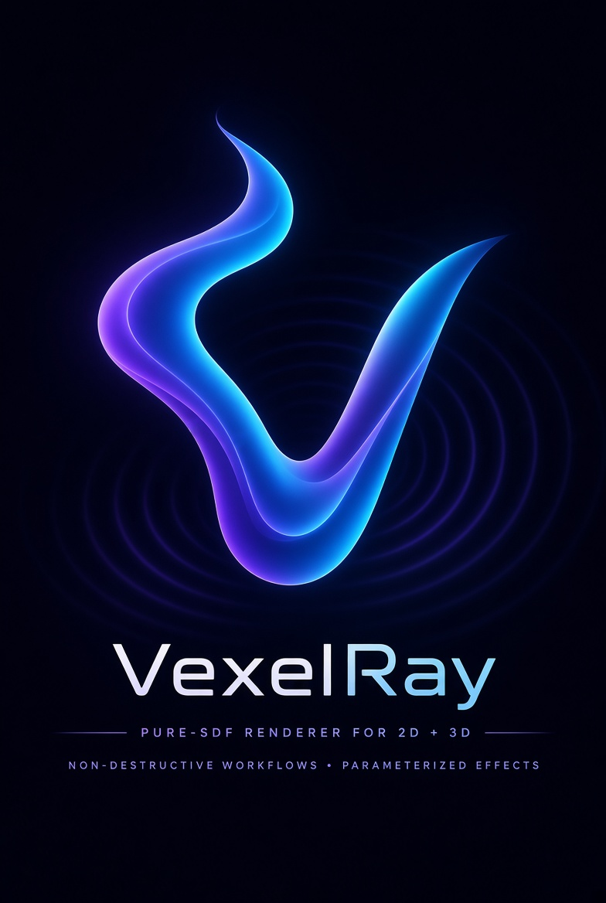

<p align="center">
  
</p>

# VexelRay

A Vulkan graphics engine whose **shaders are generated programmatically at runtime**. A hybrid polygon
rasterizer and SDF ray-marcher with a build-your-own-pipeline configuration API, flexible buffer management,
and pluggable lighting models.

- **Java 25 · Maven · GraalVM native-image · Vulkan + Panama (FFM) · JOML** — no LWJGL, no GLFW, no SDL
- Depends on the sibling **[SupirVast](../supirvast)** project for the entire shader story: engine-level
  descriptions compose into SupirVast `core` IR, which lowers to validated SPIR-V. VexelRay never emits SPIR-V
  itself — it composes *meaning*, SupirVast owns the *encoding*.

## Architecture

VexelRay **owns its Vulkan runtime** (one instance/device/swapchain shared across passes), unlike SupirVast's
monolithic single-shader hosts. That shared device is what lets a raster pass and a ray-march pass write one
coherent frame.

Multi-module Maven reactor, dependencies pointing downward:

```
vexelray                 parent (pom)
├─ vexelray-diagnostics  one class: how a seam says it silently dropped something the caller asked for
├─ vexelray-trace        @Trace sites and the guarded entry they call (docs/trace.md)
├─ vexelray-trace-maven-plugin  the weaver that rewrites every @Trace method after javac
├─ vexelray-ir           terse vocabulary for authoring core IR by hand — depends on vastir alone
│    dev.vexelray.ir        Ir: constants, vectors, arithmetic, core's type discipline (broadcast, typed zero)
├─ vexelray-core         binding-agnostic engine vocabulary — no SupirVast, no Vulkan
│    dev.vexelray.runtime   EngineConfig: what is knowable before a device exists
│    dev.vexelray.target    Target + AttachmentFormat + ImageHandle — what is rendered into, named without
│                           naming Vulkan
│    dev.vexelray.lighting  pluggable lighting models that participate in shader composition
├─ vexelray-engine-api   THE public API: the pipeline-building DSL (Target + RenderPipeline), the
│    dev.vexelray.engine    RenderTechnique SPI + TechniqueContext/FrameContext, and EngineEvents (the topics
│                           the engine publishes on an Atchung! bus). Core + the bus + JDK.
├─ vexelray-engine-vulkan-api  the Vulkan half of the SPI, so a technique compiles against a contract and not
│    dev.vexelray.engine.vulkan  against a runtime: VulkanTechniqueContext (D18)
├─ vexelray-shader       runtime shader generation (the SupirVast seam) — depends on vexelray-core + SupirVast
│    dev.vexelray.shader    ShaderComposer (engine concept -> core IR), ComposedShader (lowers via
│                           CoreToSpirv to a SPIR-V byte[]), ShaderKey + ShaderCache, Shading/ShadingPoint
├─ vexelray-surface      surfaces as data: a sealed Surface record tree lowered to core IR
│    dev.vexelray.surface   SurfaceCompiler -> Field (distance expr + marchability bound); Gradient
│                           differentiates the IR symbolically and Normalize rescales by it, so an arbitrary
│                           implicit expression becomes sphere-traceable. See docs/surface-compiler.md.
├─ vexelray-technique-sdf  the SDF technique: surface + lighting model -> fullscreen ray-march fragment
│    dev.vexelray.technique.sdf  SdfComposer, SdfScene, MarchSettings; ConeField is the same march with the
│                           geometry read from a storage buffer instead of compiled in — one pipeline for
│                           every scene, so new geometry is a buffer copy rather than a shader build
├─ vexelray-msdf-maven-plugin  build-time MSDF atlas generator (Maven plugin), used by vexelray-text
├─ vexelray-msdf-tool-windows  the msdf-atlas-gen.exe that plugin runs on Windows (elsewhere: committed atlases)
├─ vexelray-text         MSDF text: atlas model (msdf-atlas-gen JSON), glyph layout, MSDF shader as core IR
│    dev.vexelray.text      AtlasData/AtlasInfo, GlyphLayout, TextLayout/TextMesh, MsdfShader
├─ vexelray-canvas       2D Canvas API: immediate-mode unified-batched geometry and its uber-shader as core IR
│    dev.vexelray.canvas    Canvas, CanvasVertex, CanvasShader, Color — shapes, text and sampled images all
│                           share one fat-vertex batch, so a whole scene composites as a single draw
├─ vexelray-shadelet-codegen  annotation processor: a generated layout for every @Style record, no reflection
├─ vexelray-shadelets    opt-in canvas effects (weight, outline, morphs) composed beside the core shadelet set
├─ vexelray-os           OS integration (nested aggregator) — direct Panama bindings, no LWJGL/GLFW
│    ├─ vexelray-os-api     platform-agnostic API: NativePlatform, NativeWindow, WindowConfig,
│    │                      Decorations + HitRegions (application-drawn window chrome); Ffi is supirvast's
│    ├─ vexelray-os-windows WindowsPlatform  (user32/kernel32 + VK_KHR_win32_surface)
│    ├─ vexelray-os-linux   LinuxPlatform    (libX11 + VK_KHR_xlib_surface)
│    └─ vexelray-os-macos   MacosPlatform    (AppKit/QuartzCore + VK_EXT_metal_surface) — skeleton
├─ vexelray-vulkan       the Panama Vulkan runtime + resource implementation; hosts the OS-activated
│                        selection profiles that pick the platform module
│    (the loader, instance and device bindings are supirvast's vastir-vulkan, dev.supirvast.vulkan)
│    dev.vexelray.vulkan.present   VulkanSwapchain, SwapchainFramebuffers, VulkanRenderPass, DepthAttachment,
│                           GraphicsPipeline, DrawCommands, VertexBuffer, AtlasTexture, SampledImage,
│                           SampledColorTarget, OffscreenDraw, WindowedPresenter
│    dev.vexelray.vulkan.offscreen OffscreenRenderer + OffscreenReadback (headless render-to-image)
├─ vexelray-present-dxgi  Windows presentation through a flip-model DXGI swapchain; Vulkan still draws everything
├─ vexelray-engine       the Vulkan runtime behind VexelEngine: window, device, swapchain, shared render pass,
│    dev.vexelray.engine.vulkan.runtime  depth, the frame loop, and the ordered list of RenderTechniques
├─ vexelray-engine-embedded  the other technique host: SampledTechniqueHost composites the same ordered list
│    dev.vexelray.engine.embedded  into a SampledColorTarget somebody else owns and presents (a GUI viewport)
├─ vexelray-technique-canvas  the canvas technique: a Canvas batch recorded into a frame the runtime began
├─ vexelray-technique-panel  the same canvas on a plane in the world: projected through the scene's camera,
│    dev.vexelray.technique.panel  sharing the frame's depth, with nothing in it fixed to a pixel size
├─ vexelray-technique-mesh  polygon meshes through the rasteriser: the march's pinhole, its ClipDepth and its
│    dev.vexelray.technique.mesh  Shading, so meshes and marched surfaces occlude and light alike
├─ vexelray-demo         Fathom — the reference demo app (first-person SDF dungeon), -Pnative single binary;
│                        HelloTechnique is the worked example a third party copies
├─ vexelray-demo-planet  a procedural exoplanet meant to be flown from orbit to the grass
└─ vexelray-experimental research harness: build/run/compare shape-definition + rendering techniques
     dev.vexelray.experimental  ComparisonHarness, Raymarcher, Metrics, SurfaceGallery, noise/blended fields
```

The `ComposedShader` `byte[]` SPIR-V boundary keeps SupirVast isolated to `vexelray-shader`; `vexelray-core`
stays free of both the shader compiler and any Vulkan binding.

### Where it's headed

**[docs/architecture.md](docs/architecture.md)** is the living target-architecture doc — the thesis (pluggable
render techniques composited into one frame), the module topology, the public pipeline-building API, and the
capability roadmap. Read it for the big picture; this README covers what exists today.
**[docs/techniques.md](docs/techniques.md)** is the guide to writing a technique of your own.

### Native integration

VexelRay talks to the OS directly through its own Panama (FFM) bindings — no LWJGL, GLFW, or SDL. Windowing and
the Vulkan surface are hand-rolled per platform, multi-platform from day one, native-image-safe, and selected at
build time by the host OS. The binding pattern is normative and documented in
**[docs/native-bindings.md](docs/native-bindings.md)** — read it before writing any native code.

## Status

**Working renderer, pre-1.0 API.** The Vulkan runtime is real end to end — instance → device → swapchain →
shaded frame — windowed and offscreen with readback. On top of it sit the surface compiler, MSDF text, and the
2D Canvas. Windows and Linux (X11) are released platforms as of 0.1.2; macOS is still a skeleton.

The pipeline API is the front door, not a design sketch. An application builds a `RenderPipeline` — a `Target`
and an ordered list of `RenderTechnique`s — and hands it to `VexelEngine.run`, which owns the window, device,
swapchain, shared render pass, depth and frame loop. Four techniques ship as modules: the SDF ray-march,
the 2D canvas, a canvas on a plane in the world, and polygon meshes. They share one colour+depth target and
occlude each other per pixel (`HybridFrameTest`, `MeshOcclusionTest`). Fathom composes a pipeline rather than
building a runtime, and `HelloTechnique` is the smallest complete technique, for a third party to copy.

**Writing your own technique:** [docs/techniques.md](docs/techniques.md) — the SPI, the four built-in
techniques, how they share depth, and a walk through `HelloTechnique`.

What is open is in [TODO.md](TODO.md). A few older demos still build their own swapchain and presenter instead of
going through the engine; they are kept on purpose as the coverage of `WindowedPresenter`'s single-pipeline path.

## See it run

The runnable demos are `main`s you can launch directly. Most are test sources of the module they exercise:

| Demo | Module | What it shows |
| --- | --- | --- |
| `HelloTechnique` | `vexelray-demo` (main) | the smallest complete technique, through the engine |
| `HybridFrameSmoke` | `vexelray-demo` (main) | a march and a canvas in one frame |
| `SdfEngineSmoke` | `vexelray-technique-sdf` | an SDF scene marched through the engine, not hand-wired Vulkan |
| `BoxCullSmoke` | `vexelray-technique-sdf` | what culling a march to its box saves, in milliseconds a frame |
| `MeshDemo` | `vexelray-technique-mesh` | meshes in a marched scene, cutting it along shared depth; a march drawn through a mesh |
| `MengerShellDemo` | `vexelray-technique-mesh` | an endless Menger lattice seen only through polygon shells |
| `PanelDemo` | `vexelray-technique-panel` | a canvas hung in a marched scene |
| `CanvasDemo` / `DynamicCanvasDemo` | `vexelray-technique-canvas` | the immediate-mode 2D API, static and per-frame |
| `TextWindowDemo` | `vexelray-technique-canvas` | MSDF text from a build-time atlas |
| `SampledSurfaceDemo` | `vexelray-technique-canvas` | a compiled surface marched into a sampled texture |
| `WindowedClearDemo` / `WindowedTriangleDemo` | `vexelray-vulkan` | swapchain present, from a clear to a shaded triangle |
| `Sdf2DWindowDemo` | `vexelray-vulkan` | the SDF-3D pipeline reused unchanged to draw 2D |
| `OffscreenTriangleSmoke` / `OffscreenScreenshotSmoke` / `SurfaceDeviceSmoke` | `vexelray-vulkan` | headless render + readback |
| `StrokeMarchSmoke` | `vexelray-technique-sdf` | a `Surface.Stroke` marched headlessly, answering *did anything get drawn* in numbers |
| `PlanetDemo` | `vexelray-demo-planet` (main) | a procedural planet, from orbit |

`StrokeMarchSmoke` is worth knowing about before you need it: "nothing renders" is three questions a window
cannot tell apart — a shader that draws nothing, a good shader with the camera pointed elsewhere, or a draw that
never happened. It runs the first in isolation and counts the pixels that are not sky.

`vexelray-demo` holds Fathom, the first-person SDF dungeon that exercises the render==sim thesis: the same
`core` IR is lowered to SPIR-V for the GPU and to a Truffle AST for CPU collision.

## Build

```bash
mvn install
```

Requires the sibling projects installed to the local `.m2` first: `vexelray-build` (every module's build plugin),
`atchung` with the `intrabuf` it needs (the bus and the logger the engine uses), `supirvast` (the shaders),
`dxgi-bridge` (presentation on Windows) and `tactroller` (input). `../vexelray-framework/bootstrap.sh` clones and
installs the whole stack in order; after changing this repo, `--from vexelray` reinstalls it and everything that
depends on it. Building an application rather than the engine? Start at the
[developer guide](https://sibarum.github.io/vexelray-framework/developers/).
